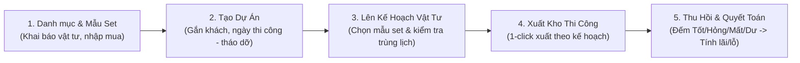

# 🌿 Cẩm Nang Sử Dụng Phần Mềm Quản Lý Kho & Dự Án — ĐẶNG WEDDING

Tài liệu này dùng để hướng dẫn vận hành cho toàn bộ đội ngũ **Đặng Wedding**: từ **Quản trị**, **Quản lý dự án**, **Thủ kho** đến **Nhân viên thi công**.

---

## 1. Quy trình chuẩn 5 bước cho một Tiệc Cưới / Sự Kiện

> [!IMPORTANT]
> **Nguyên tắc cốt lõi của kho Đặng Wedding:**
> Mọi vật tư trong kho được chia làm **2 loại** với cách quản lý hoàn toàn khác nhau:
> - 🟢 **Tiêu hao (`TH` — dùng 1 lần):** Hoa tươi, bóng bay, băng keo, formex in ấn... Khi xuất cho dự án là trừ khỏi kho. Khi tiệc xong, nếu còn dư nguyên cuộn/nguyên bịch thì nhập lại **SL dư**.
> - 🔵 **Tái sử dụng (`TSD` — đồ decor & dụng cụ):** Khung backdrop, đèn, vải rèm, hoa lụa, bàn ghế, thang, kìm... Khi xuất cho dự án thì chuyển sang trạng thái **"Đang ở dự án"**. Khi tháo dỡ xong bắt buộc phải **Thu hồi** và phân loại: **Tốt / Hỏng (chờ sửa) / Mất**.

---

## 2. Phân quyền theo 4 vai trò trong đội ngũ

| Vai trò | Ai đảm nhận | Quyền hạn trên phần mềm |
|---|---|---|
| 👑 **Quản trị (`Admin`)** | Chủ thương hiệu (Anh) | Toàn quyền hệ thống + Duyệt tài khoản nhân viên mới + Phân quyền tại mục **Người dùng**. |
| 📊 **Quản lý (`Manager`)** | Quản lý điều hành / Sale Lead | Tạo dự án, nhập **Giá trị hợp đồng**, nhập **Chi phí khác**, xem **Quyết toán lãi/lỗ** và toàn bộ báo cáo tài chính. |
| 📦 **Thủ kho (`Storekeeper`)** | Phụ trách kho vật tư | Thêm/sửa vật tư, tạo phiếu **Nhập mua / Xuất dự án / Thu hồi / Sửa xong / Kiểm kê**. *(Không thấy giá trị hợp đồng và lợi nhuận dự án)*. |
| 🛠️ **Nhân viên thi công (`Staff`)** | Đội thi công hiện trường | Chỉ nhìn thấy **các dự án mình được phân công**, xem danh sách đồ cần mang đi và bấm **Xác nhận thu hồi** sau khi tháo dỡ tiệc. |

> [!TIP]
> **Cách duyệt nhân viên mới:**
> 1. Nhân viên mở link web của **Đặng Wedding**, chọn **Đăng ký** bằng Email & Họ tên.
> 2. Sau khi đăng ký, màn hình nhân viên sẽ báo *"Tài khoản đang chờ Quản trị duyệt"*.
> 3. Anh (Quản trị) vào menu **👥 Người dùng**, đổi vai trò của nhân viên từ `Chờ duyệt` sang `Thủ kho`, `Nhân viên thi công` hoặc `Quản lý`.

---

## 3. Hướng dẫn chi tiết từng chức năng

### 3.1. Danh mục Vật tư & Quy tắc đặt mã tự động (`📦 Vật tư`)
1. Vào menu **📦 Vật tư** → bấm **+ Thêm vật tư**.
2. Chọn **Phân loại** (`Tiêu hao` hoặc `Tái sử dụng`) và chọn **Danh mục / Nhóm vật tư** (có sẵn 12 nhóm chuẩn ngành cưới).
3. **Mã vật tư tự động sinh** theo công thức `[LOẠI]-[NHÓM]-[3 chữ số]` và **tự kiểm tra chống trùng 3 lớp**:
   - Ví dụ Tiêu hao: `TH-HOA-001` (Hoa tươi), `TH-BONG-001` (Bóng bay), `TH-IN-001` (In ấn & Formex).
   - Ví dụ Tái sử dụng: `TSD-KHUNG-001` (Khung & Backdrop), `TSD-DEN-001` (Đèn), `TSD-HOALUA-001` (Hoa lụa).
4. Điền các thông số quan trọng:
   - **Tồn tối thiểu:** Ví dụ băng keo đặt tồn tối thiểu là `10`. Hễ trong kho còn dưới 10 cuộn, trang Tổng quan và danh sách sẽ báo đỏ **⚠️ Dưới tối thiểu**.
   - **Số lần sử dụng dự kiến** *(chỉ dành cho đồ Tái sử dụng)*: Ví dụ khung cổng sắt mua `2.000.000 ₫`, dự kiến dùng `20` tiệc → điền `20`. Mỗi tiệc xuất khung này đi, hệ thống tự tính khấu hao `100.000 ₫` vào chi phí tiệc đó và tính % hoàn vốn của chiếc khung.

---

### 3.2. Nhập hàng vào kho & Xử lý đồ sửa chữa (`📝 Nhập kho / Phiếu kho`)
Vào menu **📝 Nhập kho / Phiếu kho**, chọn đúng tab nghiệp vụ:
- **Tab 1 — Nhập mua vật tư mới:** Chọn Nhà cung cấp, ngày nhập, thêm nhiều dòng vật tư + số lượng + đơn giá nhập. Khi bấm Lưu, tồn kho tăng lên và **Giá nhập gần nhất** của vật tư được tự động cập nhật.
- **Tab 2 — Điều chỉnh kiểm kê:** Dùng khi kiểm kho thực tế thấy lệch (nhập số dương `+5` để cộng thêm, hoặc số âm `-2` để trừ bớt).
- **Tab 3 — Sửa xong nhập lại kho:** Khi đồ tái sử dụng thu hồi về bị hỏng (nằm ở cột *Chờ sửa*), sau khi thợ hàn/sửa xong, vào đây chuyển từ *Chờ sửa* về lại *Trong kho*.
- **Tab 4 — Thanh lý đồ hỏng:** Nếu đồ ở trạng thái *Chờ sửa* bị hỏng nặng không sửa được nữa, chọn tab này để xóa khỏi danh sách chờ sửa.

---

### 3.3. Tạo Mẫu Set Trang Trí để xuất nhanh (`✨ Mẫu set trang trí`)
Để không phải chọn lẻ từng cành hoa, từng thanh khung cho mỗi đám cưới:
1. Vào menu **✨ Mẫu set trang trí** → bấm **+ Tạo mẫu set mới**.
2. Đặt tên ví dụ: *"Set Cổng Hoa Lụa Pastel 3m"* hoặc *"Set Backdrop Chụp Hình Gia Tiên"*.
3. Thêm danh sách các vật tư và số lượng định mức vào set → bấm **Lưu**.
4. Sau này khi có tiệc cưới dùng set đó, chỉ cần **1 cú bấm "Áp dụng mẫu set"** là toàn bộ vật tư được nạp vào dự án.

---

### 3.4. Quản lý Dự án Tiệc Cưới từ lúc Báo giá đến Quyết toán (`🎪 Dự án`)

#### Bước A: Tạo dự án mới
1. Vào **🎪 Dự án** → bấm **+ Tạo dự án mới**.
2. Hệ thống tự động sinh mã `DA-YYMM-001` (theo năm/tháng ngày thi công).
3. Nhập Tên tiệc cưới, Khách hàng, Địa điểm, **Ngày thi công** và **Ngày tháo dỡ**, chọn Người phụ trách, tick chọn **Thành viên tham gia thi công** và nhập **Giá trị hợp đồng** *(chỉ Quản trị & Quản lý thấy)*.

#### Bước B: Vào chi tiết dự án (bấm **"Mở dự án"**) — 5 Tab vận hành
1. **Tab 1 — 📋 Kế hoạch vật tư (Giữ chỗ & Kiểm tra trùng lịch):**
   - Bấm **"✨ Áp dụng mẫu set"** để nạp nhanh cả bộ trang trí, hoặc thêm lẻ từng món.
   - **Cảnh báo trùng lịch tự động:** Nếu trong cùng khoảng ngày thi công → tháo dỡ đó có 2 hoặc 3 đám cưới cùng cần dùng *Khung tròn 2.5m* mà tổng số lượng cần vượt quá tổng số khung Đặng Wedding đang sở hữu, hệ thống sẽ **báo đỏ số lượng thiếu** ngay lập tức để anh chuẩn bị thuê ngoài hoặc mua thêm trước ngày tiệc.
2. **Tab 2 — 📤 Xuất cho dự án:**
   - Đến ngày đi setup tiệc, Thủ kho bấm nút **"⚡ Xuất toàn bộ theo kế hoạch"** (chỉ 1 giây là tạo xong toàn bộ phiếu xuất kho), hoặc xuất bổ sung từng món.
3. **Tab 3 — 📥 Thu hồi sau sự kiện:**
   - Sau khi tháo dỡ tiệc về kho, Thủ kho hoặc Nhân viên thi công mở tab này:
   - Với **Đồ tái sử dụng**: hệ thống hiện sẵn số lượng đang cầm ở dự án, chỉ cần điền vào 3 ô **SL Tốt** (về lại kho), **SL Hỏng** (chuyển sang chờ sửa), **SL Mất** (tính vào thiệt hại dự án).
   - Với **Đồ tiêu hao**: nếu mang đi 10 bịch bóng mà chỉ dùng 8 bịch, điền `2` vào ô **SL dư trả kho**.
4. **Tab 4 — 💸 Chi phí khác** *(Quản trị / Quản lý)*:
   - Ghi nhận tiền công thợ thời vụ, tiền xe tải vận chuyển, tiền thuê âm thanh/ánh sáng ngoài...
5. **Tab 5 — 💰 Tổng kết & Quyết toán Lãi/Lỗ** *(Quản trị / Quản lý)*:
   - Hệ thống tự động tính ra bảng quyết toán chi tiết cho đám cưới đó:
     $$\text{Lợi nhuận ròng} = \text{Giá trị hợp đồng} - \left(\text{Chi phí tiêu hao thực dùng} + \text{Khấu hao đồ tái sử dụng} + \text{Giá trị đồ hỏng/mất} + \text{Chi phí khác}\right)$$

---

### 3.5. Xem Báo cáo, Dự báo mua hàng & Xuất Excel (`📈 Báo cáo & Dự báo`)
Mở menu **📈 Báo cáo & Dự báo**, anh có 7 góc nhìn quản trị:
1. **Tồn kho hiện tại:** Tổng hợp Trong kho / Đang ở dự án / Chờ sửa / Giá trị tồn.
2. **Đồ đang ở đâu:** Biết chính xác món đồ nào đang nằm ở đám cưới nào chưa thu hồi về, dự án nào đã quá ngày tháo dỡ mà chưa trả đồ.
3. **Tỷ lệ hư hỏng & mất:** Xem vật tư nào hay bị hỏng/mất nhất để nhắc nhở đội thi công.
4. **Lãi / Lỗ theo dự án:** So sánh doanh thu, tổng chi phí và tỷ suất lợi nhuận (%) giữa các tiệc cưới.
5. **Vật tư dùng nhiều nhất:** Top những mặt hàng xuất kho nhiều nhất.
6. **Hoàn vốn đồ tái sử dụng:** Xem từng khung sắt, bộ đèn đã thu hồi được bao nhiêu % vốn đầu tư ban đầu qua các lần đi tiệc.
7. **🔮 Dự báo thông minh:**
   - Tự tính tốc độ tiêu hao trung bình 90 ngày qua → báo **Số ngày dự kiến hết hàng** và **Gợi ý số lượng cần mua thêm cho 30 ngày tới**.
   - Đối chiếu kế hoạch của các đám cưới trong 30 ngày sắp tới với tồn kho hiện tại → báo trước danh sách vật tư bị thiếu.

> [!NOTE]
> **Xuất dữ liệu ra Excel (`.xlsx`):**
> - Ở góc trên mỗi trang đều có nút **📥 Xuất Excel** để tải bảng hiện tại.
> - Tại trang **Báo cáo & Dự báo**, nút **📥 Xuất toàn bộ dữ liệu thô** ở góc phải trên cùng sẽ tải về 1 file Excel duy nhất chứa đầy đủ tất cả các sheet (`VatTu`, `DuAn`, `TaiChinhDuAn`, `KeHoachVatTu`, `ChiPhiKhac`, `SoKho`, `DoiTac`, `MauSet`).
